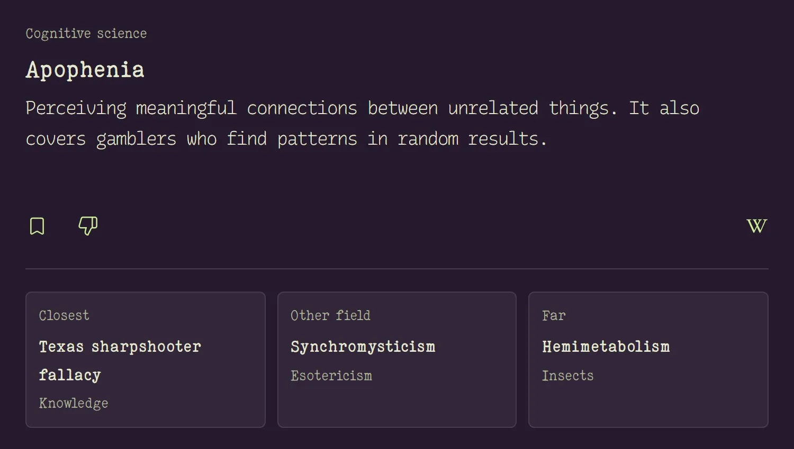

# dérive

[dérive](https://gustavecortal.com/concept-space/) is a recommender over concept embeddings that suggests rare concepts close to or far from your taste, learned by Rocchio relevance feedback. This repository runs the same recommender in a terminal.

<p align="center">
  <a href="https://gustavecortal.com/concept-space/"></a>
</p>

## Quick start

With [Node.js](https://nodejs.org/) 24 or later, and no npm packages:

```bash
git clone https://github.com/gustavecortal/derive.git
cd derive
node read.ts
```

Type an option's number to read it, `s` to save the card, `d` to dislike it, and `q` to quit.

## How it works

Each of the 2,028 concepts is embedded from its term and description with [Qwen3-Embedding-4B](https://huggingface.co/Qwen/Qwen3-Embedding-4B). Under each card, **Closest** is the unread concept most similar to it. **Other field** is the one most similar to your taste, outside the fields of the card and of Closest. **Far** is drawn among the concepts least like the last ten you read. Your taste is the mean embedding of the concepts you picked or saved, minus half that of those you disliked.

## Rebuild the embeddings

With [uv](https://docs.astral.sh/uv/getting-started/installation/):

```bash
uv run embed.py
```

This rewrites `data/vectors.bin` from `data/concepts.json`. The model is an 8 GB download and runs in under a minute on a GPU, or over half an hour on a CPU.

## License

The code is under the [MIT license](LICENSE). The concepts are under [CC BY-SA 4.0](data/LICENSE), since many descriptions are adapted from Wikipedia.
