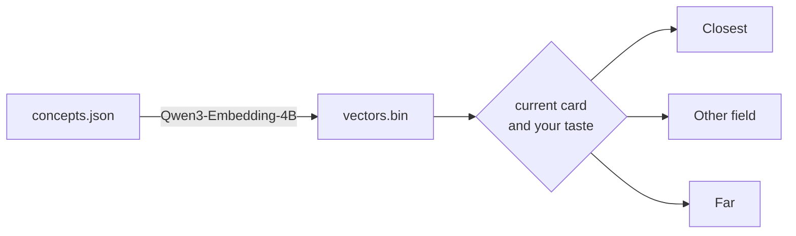

# dérive

[dérive](https://gustavecortal.com/concept-space/) is a recommender over concept embeddings that suggests rare concepts close to or far from your taste, learned by Rocchio relevance feedback. Many come from [a list I have kept while reading for years](https://gustavecortal.com/concept-space/list/).

<p align="center">
  <a href="https://gustavecortal.com/concept-space/"></a>
</p>

## Quick start

With [Node.js](https://nodejs.org/) 22.18 or later, which runs TypeScript directly:

```bash
git clone https://github.com/gustavecortal/derive.git
cd derive
node read.ts
```

Type an option's number to read it, `s` to save the card, `d` to dislike it, and `q` to quit. The recommender is the one the [web page](https://gustavecortal.com/concept-space/) runs, and it needs no packages.

## Rebuild the embeddings

With [uv](https://docs.astral.sh/uv/getting-started/installation/), which installs the script's dependencies:

```bash
uv run embed.py
```

This embeds every concept of `data/concepts.json` with [Qwen3-Embedding-4B](https://huggingface.co/Qwen/Qwen3-Embedding-4B) and rewrites `data/vectors.bin`. It uses a CUDA, Intel or Apple GPU when PyTorch finds one, and the CPU otherwise. On an Intel Arc A770 it takes under a minute and reproduces the shipped file byte for byte. To embed your own concepts, give a file in the same format: `uv run embed.py --concepts mine.json --out mine.bin`.

## How it works



Each of the 2,028 concepts is embedded from its term and one-sentence description. The vectors keep their first 512 dimensions, are centred on the corpus mean and stored as int8.

**Closest** is the unread concept most similar to the one you are reading. **Other field** is the one most similar to your taste, outside the fields of these two. **Far** is drawn at random among the 30 concepts least similar to the nearest of the last 10 you read.

Your taste is a Rocchio vector: the mean embedding of the concepts you picked or saved among the last 50 you read, minus half the mean of those you disliked. Until you pick, save or dislike one, **Other field** follows the concept you are reading instead. Options you pass over are not offered again while you read the next 10.

| File | Contents |
|---|---|
| [`src/ways.ts`](src/ways.ts) | The three options under a card |
| [`src/reader.ts`](src/reader.ts) | The Rocchio taste vector |
| [`src/reading.ts`](src/reading.ts) | A reading session: history, marks and passed-over options |
| [`src/corpus.ts`](src/corpus.ts) | Similarity, normalization and synonym groups |
| [`src/corpus-file.ts`](src/corpus-file.ts) | Reads the two data files |
| [`embed.py`](embed.py) | Writes `data/vectors.bin` |
| [`read.ts`](read.ts) | The terminal reader |

## License

The code is under the [MIT license](LICENSE). The concepts are under [CC BY-SA 4.0](data/LICENSE), since many descriptions are adapted from Wikipedia. Qwen3-Embedding-4B is under Apache 2.0.
