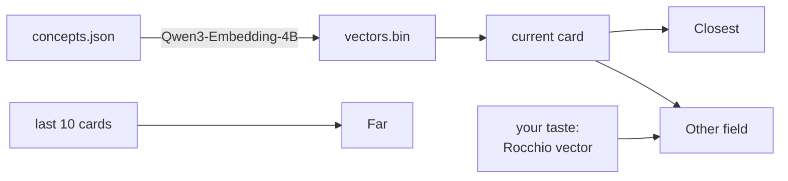

# dérive

[dérive](https://gustavecortal.com/concept-space/) is a recommender over concept embeddings that suggests rare concepts close to or far from your taste, learned by Rocchio relevance feedback. Many come from [a list I have kept while reading for years](https://gustavecortal.com/concept-space/list/). The [live demo](https://gustavecortal.com/concept-space/) runs in the browser, and this repository runs the same recommender in a terminal.

<p align="center">
  <a href="https://gustavecortal.com/concept-space/"></a>
</p>

## Quick start

With [Node.js](https://nodejs.org/) 24 or later, which runs TypeScript directly:

```bash
git clone https://github.com/gustavecortal/derive.git
cd derive
node read.ts
```

Type an option's number to read it, `s` to save the card, `d` to dislike it, and `q` to quit. `read.ts` needs no npm packages, and `node --test test.ts` checks that its first options are the web page's.

## How it works



Each of the 2,028 concepts is embedded from its term and one-sentence description. The vectors keep their first 512 dimensions (the model is trained so that leading dimensions work alone), are centred on the corpus mean and stored as int8.

**Closest** is the unread concept most similar to the one you are reading. **Other field** is the one most similar to your taste, outside the fields of these two. **Far** is drawn at random among the 30 concepts least like any of the last 10 you read.

Your taste is a Rocchio vector: the mean embedding of the concepts you picked or saved among the last 50 you read, minus half the mean of those you disliked. Until you pick, save or dislike one, **Other field** follows the concept you are reading instead. Options you pass over are not offered again while you read the next 10.

| File | Contents |
|---|---|
| [`src/ways.ts`](src/ways.ts) | The three options under a card |
| [`src/taste.ts`](src/taste.ts) | The Rocchio taste vector |
| [`src/reading.ts`](src/reading.ts) | A reading session: history, marks and passed-over options |
| [`src/corpus.ts`](src/corpus.ts) | Loads the concepts and their vectors |
| [`read.ts`](read.ts) | The terminal reader |
| [`embed.py`](embed.py) | Writes `data/vectors.bin` |

## Rebuild the embeddings

With [uv](https://docs.astral.sh/uv/getting-started/installation/), which installs the script's dependencies:

```bash
uv run embed.py
```

This embeds every concept of `data/concepts.json` with [Qwen3-Embedding-4B](https://huggingface.co/Qwen/Qwen3-Embedding-4B) and rewrites `data/vectors.bin`. The model is an 8 GB download. It runs on a CUDA, Intel or Apple GPU when PyTorch finds one, in under a minute on a GPU with 16 GB. On a desktop CPU it takes over half an hour. The shipped file was made on an Intel Arc A770 with PyTorch's XPU build, which reproduces it byte for byte. Other devices round in bfloat16 differently, so their vectors may differ in the last bits.

To read your own concepts, write a `concepts.json` in the same format: `dimensions` (at most 2,560), `clusterLabels` (the field names), and `concepts`, each with an `id`, a `term`, a one-sentence `hook`, a `cluster` (the index of its field) and a `group` (the index of the first concept with the same meaning, or its own). Then:

```bash
uv run embed.py --concepts mine/concepts.json --out mine/vectors.bin
node read.ts --data mine
```

## License

The code is under the [MIT license](LICENSE). The concepts are under [CC BY-SA 4.0](data/LICENSE), since many descriptions are adapted from Wikipedia. Qwen3-Embedding-4B is under Apache 2.0.
